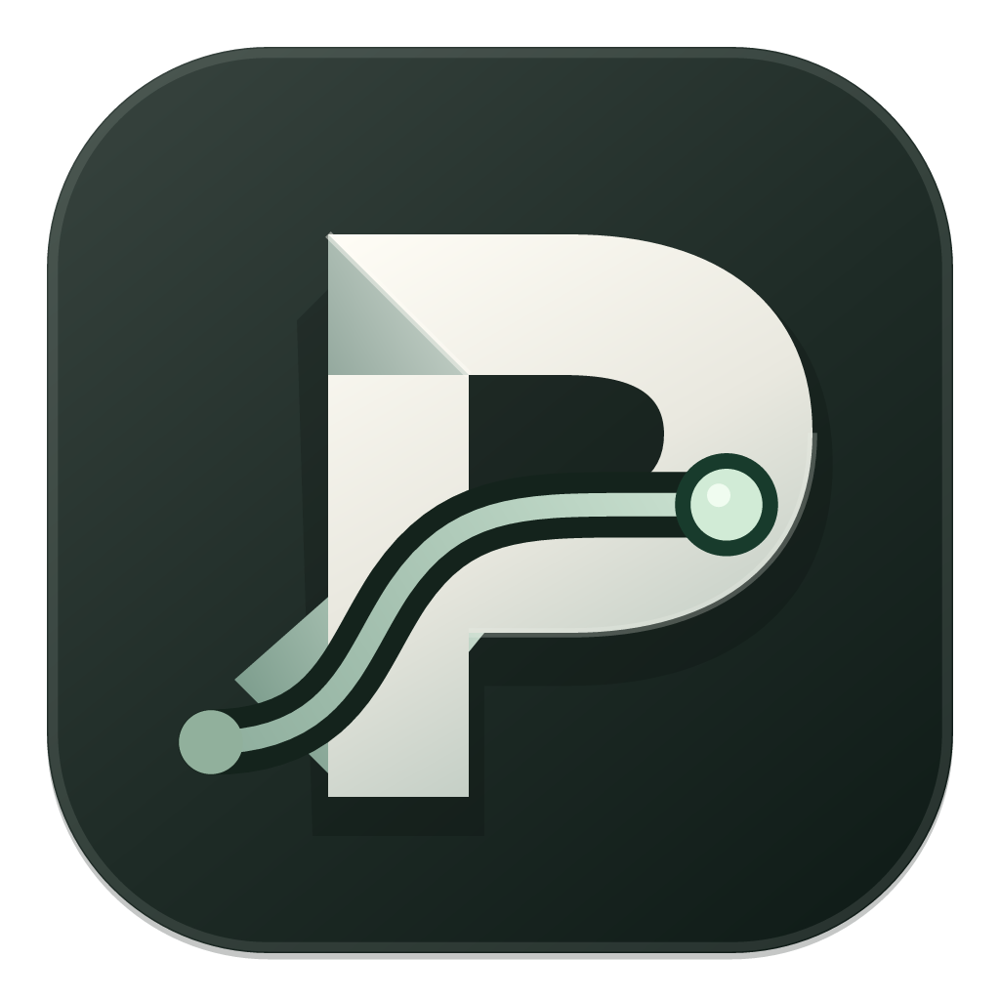

<div align="center">
  
  <h1>PaperTrail</h1>
  <p><strong>Every manuscript has a trail.</strong></p>
  <p>A lightweight manuscript tracker for macOS and Windows.<br>专注稿件进度的 macOS 菜单栏与 Windows 托盘工具。</p>
  <p>
    <a href="https://github.com/xuxiaoooo/PaperTrail/releases/latest">Download for Mac / 下载 Mac 版</a> ·
    <a href="#中文">中文</a> · <a href="#english">English</a>
  </p>
  
  
  
  
  
</div>

## Screenshots / 界面预览

| 主窗口 / Main window | 菜单栏快览 / Menu bar overview |
| :---: | :---: |
|  |  |

截图来自实际运行的界面，使用合成演示数据。 / Screenshots show the running app with fictional manuscript data.

<details>
<summary>本地变化日志 / Local change history</summary>
<br>

</details>

## 中文

### 一眼看到稿件进度

PaperTrail 把你添加的稿件集中在一个紧凑的竖向窗口中。每篇稿件只显示 **期刊名称、当前状态、稿件号和本地变化日期**。无需建立作者档案，也无需为 PaperTrail 注册云端账号。

点击 Mac 菜单栏图标或 Windows 任务栏右下角通知区域的图标，即可快速查看全部已跟踪稿件。圆形箭头刷新状态；底部分隔线下可打开主窗口或退出应用。

### 轻量化，体现在运行方式

| 设计 | 实际行为 |
| --- | --- |
| 界面按需存在 | 主窗口关闭后销毁页面进程；菜单栏弹窗失焦后销毁。后台驻留时可保持 **0 个界面渲染进程**。 |
| 浏览器按需运行 | 读取投稿网站时启动浏览器，**空闲 30 秒后关闭**；账号会话保存在本机。 |
| 限制读取并发 | 最多同时读取 **2 个账号**，降低读取时的内存峰值。 |
| 内容集中 | 稿件卡片、期刊账号、本地变化日志；保留需要的备份、时区与启动设置。 |

一次本机开发阶段对比中，两个稿件场景的进程 RSS 总和从 **1,227.6 MB 降至 511.2 MB，约减少 58.4%**，进程数量从 **15 个降至 5 个**。这是单机样本，不代表所有设备上的占用；RSS 总和也不等于实际物理内存占用。当前版本的界面开启／关闭样本和测量方法见 [资源占用记录](docs/performance/README.md)。

离线安装包包含 Electron、Python、Node.js、Chromium 和 Firefox。Mac 当前发行包约 545 MiB；Windows 包大小以构建产物为准。安装和首次启动可离线完成；读取期刊网站状态需要联网。

### 功能

- **按稿件号跟踪**：只跟踪你主动添加的稿件，保留网站提供的原始状态文字。
- **本地变化记录**：记录添加后的状态变化、变化次数及最近变化日期，不回溯网站旧历史。
- **定时刷新**：按所选时区，每天 **08:00–24:00 每小时检查一次**，也可手动刷新。
- **人工验证入口**：遇到网站验证时，可打开独立账号的验证窗口完成登录。
- **本地备份**：导出和恢复稿件、日志与设置；密码和浏览器会话不进入备份。

### 支持的投稿入口

| 平台 | 登录方式 |
| --- | --- |
| ScholarOne | 期刊账号和密码 |
| Editorial Manager | 期刊账号和密码 |
| Wiley Research Exchange | Wiley 账号和密码 |
| Elsevier 使用的 Editorial Manager | Elsevier 账号和密码 |
| IEEE Research Exchange 投稿门户 | IEEE 账号和密码 |

使用具体期刊的投稿入口。不同期刊的网站页面可能不同，适配范围及入口格式见 [平台说明](docs/平台适配范围.md)。
Springer Nature 期刊若使用上表中的 Editorial Manager 或 ScholarOne 入口，可以尝试对应读取器；**SNAPP／Springer Nature Profile 目前尚无专用自动读取器**。

### 为 Mac 设计

- **Apple Silicon（arm64），macOS 14 或更新版本**；本次发布在 macOS 27.0.1 上验证。
- 原生菜单栏入口、Retina 图标、紧凑的竖向主窗口。
- 默认窗口约为主屏幕 **1/4 宽、2/3 高**，可调整大小。
- 主窗口关闭后，运行中的 Dock 图标随之隐藏；可通过菜单栏重新打开。
- 密码交由 **macOS 钥匙串**保存；可设置登录电脑时启动。
- 内置读取组件，首次使用无需另装 Python、Node.js 或浏览器。

### 安装与开始使用

1. 从 [Releases](https://github.com/xuxiaoooo/PaperTrail/releases/latest) 下载 `PaperTrail-1.1-Mac.dmg`。
2. 打开 DMG，将 `PaperTrail.app` 拖到“应用程序”。
3. 启动 PaperTrail，在“期刊账号”中添加期刊网址及账号。
4. 添加稿件号，完成网站验证后刷新，即可开始跟踪。

**当前发行包使用本地签名，尚未经过 Apple 公证。** macOS 首次打开可能提示开发者验证；相关机制及手动处理方式见 [Apple 官方说明](https://support.apple.com/guide/mac-help/open-a-mac-app-from-an-unknown-developer-mh40616/mac)。Release 同时提供 SHA-256 校验文件和完整源码。

数据目录：`~/Library/Application Support/PaperTrail/`。日常操作见 [使用指南](docs/使用指南.md)。

### Windows 版本（win 分支）

- Windows x64 使用右下角通知区域图标。快览浮窗会贴近图标并避开任务栏；关闭主窗口后仍可从托盘打开。
- 主窗口使用系统窗口按钮与一体式顶栏；应用菜单按 `Alt` 显示。密码使用当前 Windows 用户的 DPAPI 加密保存在本机。
- Windows 安装包为 `PaperTrail-1.1-Windows-Offline.exe`，由 [GitHub Actions 构建](https://github.com/xuxiaoooo/PaperTrail/actions/workflows/build.yml)产生。下载 `PaperTrail-windows-x64` 构建产物后解压，再运行安装程序。此分支的安装包未进行代码签名。
- 数据目录：`%LOCALAPPDATA%\PaperTrail\`。安装包已内置 Python、Node.js 和读取所需的浏览器组件。

## English

### Manuscript progress at a glance

PaperTrail brings the manuscripts you add into a compact portrait window. Each card shows **journal, current status, manuscript number, and the latest local change date**. It requires no author profile or separate PaperTrail cloud account.

Click the macOS menu bar icon or the Windows notification-area icon to see every tracked manuscript. Refresh from the popover, open the main window, or quit from the footer.

### Designed for quiet background use

| Design | Behavior |
| --- | --- |
| On-demand interface | Closing the main window disposes its renderer. The popover is disposed when it loses focus. Background use can retain **zero UI renderer processes**. |
| On-demand reading browsers | Browsers start for journal reads and close after **30 seconds of inactivity**. Account sessions stay on the device. |
| Bounded concurrency | At most **two accounts** are read at once, limiting memory peaks. |
| Focused workflow | Manuscript cards, journal accounts, local history, backups, timezone and startup settings. |

A local development comparison with two tracked manuscripts recorded total process RSS falling from **1,227.6 MB to 511.2 MB, about 58.4%**, and the process count from **15 to 5**. This is a single-machine observation, not a memory guarantee. Summed RSS is not physical memory footprint. See [resource measurements](docs/performance/README.md) for the current open-window/background samples and methodology.

The offline installer includes Electron, Python, Node.js, Chromium and Firefox. The current Mac release is approximately 545 MiB; check the build artifact for the Windows size. Installation and first launch work offline; checking publisher websites needs an internet connection.

### Features

- **Track by manuscript number.** Follow the manuscripts you add and retain the publisher's original status wording.
- **Keep a local trail.** Record subsequent status changes, change counts and dates; existing publisher history is not imported.
- **Refresh hourly.** Check each hour from **08:00 through 24:00** in the selected timezone, with manual refresh available.
- **Handle verification.** Open the relevant account's verification window when the website requires it.
- **Back up locally.** Export and restore manuscripts, history and settings. Passwords and browser sessions are excluded from portable backups.

### Submission systems

| System | Sign-in |
| --- | --- |
| ScholarOne | Journal username and password |
| Editorial Manager | Journal username and password |
| Wiley Research Exchange | Wiley username and password |
| Elsevier journals on Editorial Manager | Elsevier username and password |
| IEEE Research Exchange portal | IEEE username and password |

Use the journal-specific submission URL. Journal pages and login requirements vary; see [supported entry points](docs/平台适配范围.md).
Springer Nature journals using a supported Editorial Manager or ScholarOne entry point can use the corresponding reader. **SNAPP and Springer Nature Profile do not yet have a dedicated automatic reader.**

### Made for Mac

- **Apple Silicon (arm64), macOS 14 or later.** This release was tested on macOS 27.0.1.
- Native menu bar access, Retina icons and a compact portrait window.
- Default window size is approximately **one quarter of screen width and two thirds of screen height**; it is resizable.
- Dock visibility follows the main window; reopen it from the menu bar.
- Passwords are stored in **macOS Keychain**, with optional launch at login.
- Reading components are bundled; no separate Python, Node.js or browser installation is needed.

### Install and start

1. Download `PaperTrail-1.1-Mac.dmg` from [Releases](https://github.com/xuxiaoooo/PaperTrail/releases/latest).
2. Open the DMG and drag `PaperTrail.app` into **Applications**.
3. Open PaperTrail and add a journal URL and account under **期刊账号** (Journal accounts).
4. Add a manuscript number, complete any website verification, and refresh.

**The current distribution is locally signed and is not Apple-notarized.** macOS may show a developer-verification notice on first launch. See [Apple's guidance](https://support.apple.com/guide/mac-help/open-a-mac-app-from-an-unknown-developer-mh40616/mac) for how the system handles these apps. SHA-256 checksums and complete source are provided with the release.

Local data directory: `~/Library/Application Support/PaperTrail/`.

### Windows build (win branch)

- On Windows x64, the overview opens from the notification area at the bottom right. Its popover stays inside the display work area and the app can remain in the tray after the main window closes.
- The main window keeps native window controls in a unified title bar; press `Alt` for the application menu. Passwords are encrypted for the current Windows user with DPAPI.
- Download the `PaperTrail-windows-x64` artifact from the [GitHub Actions build](https://github.com/xuxiaoooo/PaperTrail/actions/workflows/build.yml), extract it, and run `PaperTrail-1.1-Windows-Offline.exe`. This branch's installer is not code-signed.
- Local data directory: `%LOCALAPPDATA%\PaperTrail\`. Python, Node.js and both reading browsers are bundled.

## Development / 开发

Requirements: **Node.js 24**, **Python 3.13**, and Xcode Command Line Tools on an Apple Silicon Mac.

```sh
git clone https://github.com/xuxiaoooo/PaperTrail.git
cd PaperTrail
npm ci
npm run prepare:mac
npm start
```

Prepare bundled runtimes once, then build the macOS installer:

```sh
npm test
npm run smoke
npm run package:mac
npm run verify:package -- macos-arm64
npm run smoke:package
```

Regenerate the public screenshots and source-development resource sample with synthetic data:

```sh
npm run docs:screenshots
```

More: [Build guide / 构建指南](docs/开发与构建.md) · [Contributing](CONTRIBUTING.md) · [Security](SECURITY.md)

## License / 许可

[PolyForm Noncommercial 1.0.0](LICENSE). Source is available for uses permitted by this license. Original required copyright notices are retained. Bundled third-party components retain their own licenses; see [third-party notices](docs/第三方组件说明.md).
